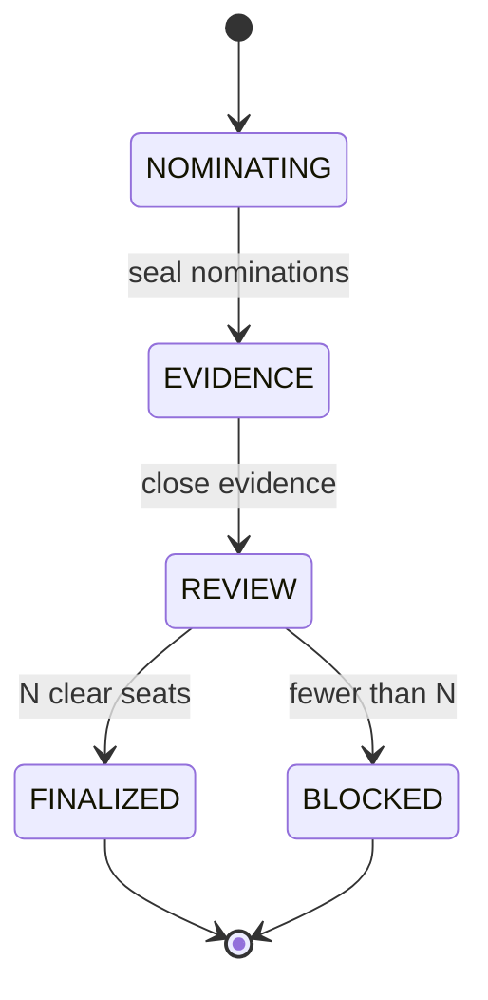

# Recusal

**A committee member's eligibility must depend on their relationship to the specific case—not merely on a generic credential.**

Recusal is a **contract-only GenLayer Intelligent Contract** that freezes a committee's
matter, recusal charter, primary nominees, and alternate pool; records signed,
write-once disclosures and bounded third-party concerns; uses independently
repeated semantic classification to identify material conflicts; then applies
deterministic exclusion and seed-ranked alternate substitution. If too few
cleared members remain, the whole panel is `BLOCKED`. A separate on-chain
consumer, `PanelVoteGate`, accepts a vote only from an actual member of the
finalized panel and only against its immutable roster digest.

This is **not** an LLM that votes, selects panel members, invents a remedy, or
proves an off-chain allegation true. A model returns one bounded relationship
classification. Contract code owns all seat assignments and the vote gate.

## Scope

- Repository: `https://github.com/lolaaa00/Recusal`.
- Network: **StudioNet `61999`** only, RPC `https://studio.genlayer.com/api`.
- Local CLI dependency: `genlayer@0.39.1` (never substitute a global preview CLI).
- Python 3.12+, `genlayer-test==0.29.2`, `genvm-linter==0.11.0`.
- No frontend, wallet UI, database, backend, Docker requirement or hosted service.
- One `Recusal` deployment per matter; one optional `PanelVoteGate` per finalized panel.

## Invariant

For a `FINALIZED` panel of `N` seats:

1. Every nominee (primaries and alternates) was assessed against the same frozen evidence horizon.
2. Every seated wallet has exactly one status of `NO_KNOWN_CONFLICT` or `NON_MATERIAL_RELATIONSHIP`.
3. No `MATERIAL_CONFLICT`, `AMBIGUOUS`, unreviewed, or missing-disclosure member is seated.
4. Cleared primaries retain nomination order. Vacancies are filled from cleared alternates sorted by the fixed SHA-256 seed score.
5. The panel either has exactly `N` unique members or is wholly `BLOCKED`.
6. The independent vote consumer verifies both final roster membership and the exact immutable roster digest.

## Lifecycle



Every boundary is one-way. Nothing writes a case after `FINALIZED` or `BLOCKED`.
Use a new deployment for a new matter or evidence horizon.

### Demonstration

Register three primary reviewers P1/P2/P3 and two alternates A1/A2. File
disclosures and public references before the evidence freeze. Validators
classify P2's disclosed paid relationship with an applicant as
`MATERIAL_CONFLICT`; P1/P3 and both alternates are `NO_KNOWN_CONFLICT`.
The deterministic algorithm produces `[P1, P3, A?]`, where A? is the clear
alternate with the lowest SHA-256 seed ranking. `PanelVoteGate` rejects P2 and
accepts the seated replacement. If A1/A2 are both ambiguous or conflicted,
finalization is `BLOCKED` instead.

### Verdict definitions

| Verdict | Consequence |
|---|---|
| `MATERIAL_CONFLICT` | Exclude member; substitute if possible |
| `NON_MATERIAL_RELATIONSHIP` | Eligible under frozen charter |
| `NO_KNOWN_CONFLICT` | Eligible based on this evidence only—not a global integrity guarantee |
| `AMBIGUOUS` | Hold out; never grant a seat until a fresh case with new evidence |

Missing disclosures are **deterministically** `AMBIGUOUS`, without an LLM call.

## Source map

| Path | Purpose |
|---|---|
| `contracts/recusal.py` | Actual GenLayer IC: immutable committee, disclosures, consensus, deterministic panel |
| `contracts/panel_vote_gate.py` | Separate IC consumer; refuses non-seated voters and mismatched digests |
| `tests/` | Offline source-loaded unit/adversarial tests with fake GenVM adapter |
| `direct_tests/` | Real GenLayer Direct Mode cases; requires SDK and must be run by Lola's agent |
| `scripts/preflight.py` | Offline syntax/configuration and source SHA-256 checks |
| `scripts/network_guard.py` | Checks exact local CLI and live chain ID **before writes** |
| `docs/` | Mechanism, security boundaries, deployment guide and status |
| `.github/workflows/verify.yml` | CI offline + GenVM/Direct Mode jobs |

## Quick checks

```bash
python -m pytest tests -q
python scripts/preflight.py
npm ci
./node_modules/.bin/genlayer --version
python -m pip install -r requirements.txt
genvm-lint check contracts/recusal.py
genvm-lint check contracts/panel_vote_gate.py
python -m pytest direct_tests -v
```

`network_guard.py` additionally performs a LIVE RPC check. If unavailable,
do not deploy; do not switch networks. For complete deployment instructions
and source verification, see [docs/DEPLOYMENT.md](docs/DEPLOYMENT.md).

**Security limitation:** Allegations, links, and on-chain disclosures do not
prove off-chain facts. GenLayer classifies the evidence provided. A false or
missing disclosure can evade detection. Public challengers can use limited
concern slots to introduce dubious allegations; cap exhaustion is a known
denial-of-service risk. See [docs/THREAT_MODEL.md](docs/THREAT_MODEL.md).

**Readiness:** 48 offline and 12 Direct Mode tests pass locally, along with the
pinned GenVM checks, but this remains a reviewable source handoff rather than a
live deployment claim. The network guard verifies StudioNet 61999, but the
authorized deployment account is not yet identified and the target GitHub
repository does not exist. See
[docs/BUILD_STATUS.md](docs/BUILD_STATUS.md) and [TEST_EVIDENCE.md](TEST_EVIDENCE.md).
